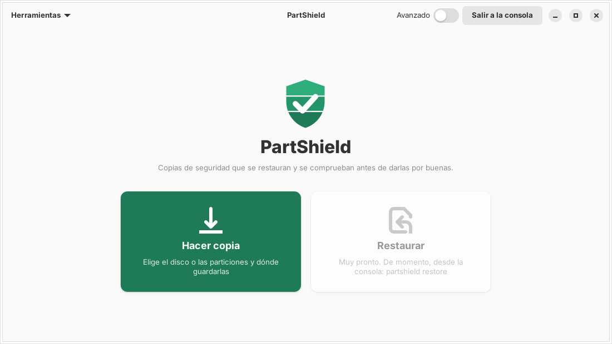
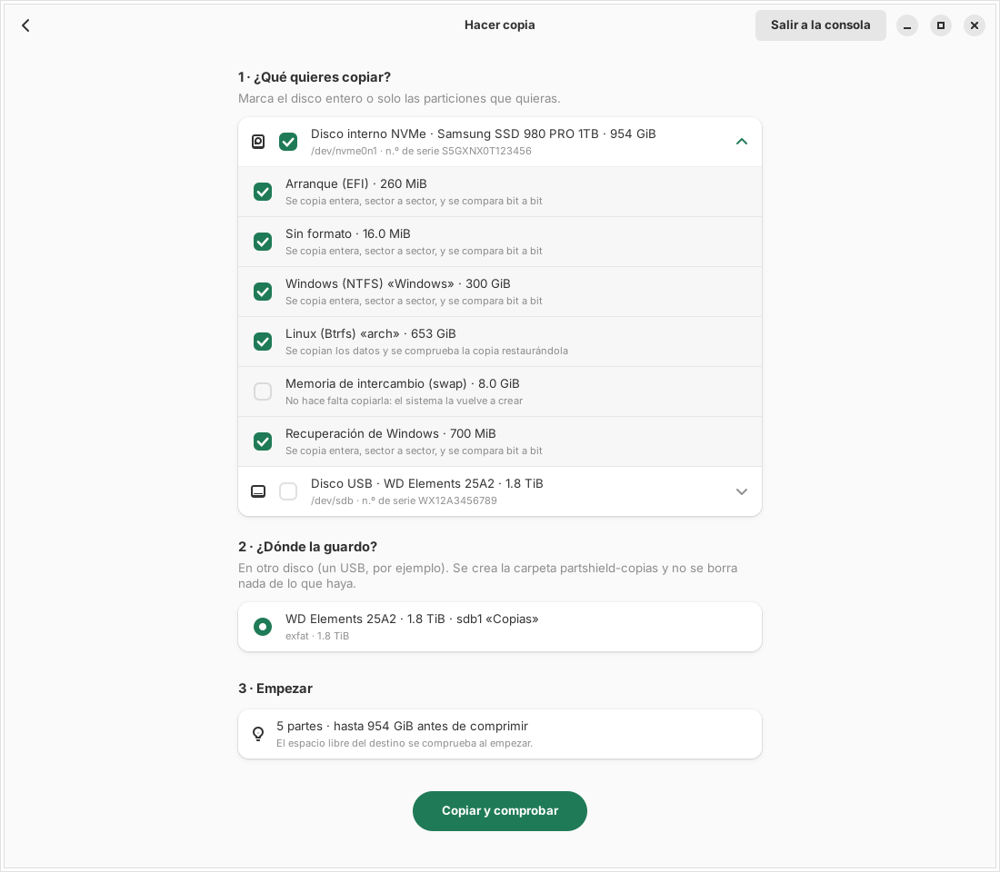
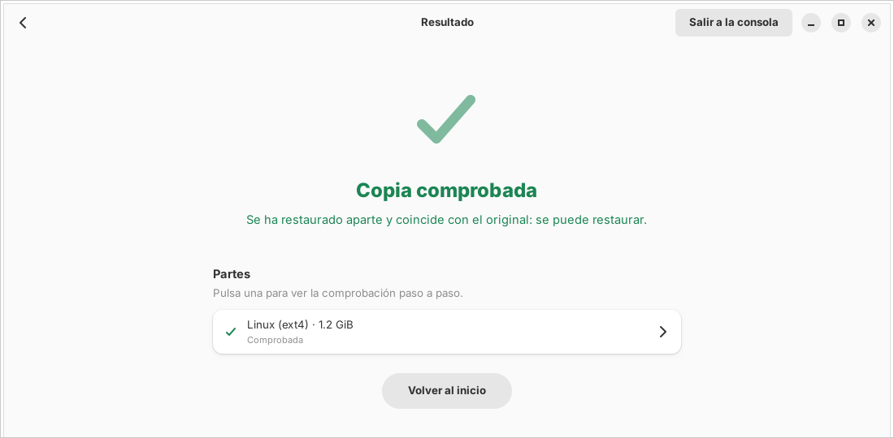

<p align="center">
  
</p>

<h1 align="center">PartShield</h1>

<p align="center">
  <strong>Copias de seguridad que se restauran y se comprueban antes de darlas por buenas.</strong>
</p>

<p align="center">
  <a href="https://partshield.io"></a>
  
  
  
  <a href="LICENSE"></a>
  <a href="https://github.com/bytebein/PartShield/actions/workflows/ci.yml"></a>
  
</p>

<p align="center">
  
</p>

---

## Por qué

Una copia no está hecha hasta que se ha restaurado.

PartShield nace de un fallo real: partclone copiaba sistemas Btrfs con
`BLOCK_GROUP_TREE` y los daba por buenos, pero no montaban porque el
`chunk_root` nunca se había copiado
([partclone#303](https://github.com/Thomas-Tsai/partclone/issues/303),
[rescuezilla#672](https://github.com/rescuezilla/rescuezilla/issues/672)).
Tres copias «correctas» que no servían para nada.

Por eso PartShield no se fía de que la copia termine sin errores. La restaura
aparte, la monta, la compara con el original y solo entonces dice si vale.

## Cómo se usa

Arranca el USB de PartShield (Debian 13 con Secure Boot, sin escritorio: solo
la aplicación) y haz la copia en tres pasos.

| | |
| --- | --- |
| **1 · Qué copiar** | El disco entero o solo las particiones que quieras, con casillas. |
| **2 · Dónde** | Otro disco, por ejemplo un USB. No se borra nada de lo que haya. |
| **3 · Empezar** | Una barra mientras se copia y se comprueba. |

<p align="center">
  
</p>

Al final, una de tres respuestas:

| | Resultado | Qué significa |
| --- | --- | --- |
| 🟢 | **Copia comprobada** | Se ha restaurado aparte y coincide con el original. Se puede restaurar. |
| 🟡 | **Sin comprobar del todo** | No falló nada, pero algún paso no se pudo hacer. Mira cuál antes de fiarte. |
| 🔴 | **No vale** | Algo falló. No confíes en esta copia. |

<p align="center">
  
</p>

El interruptor **Avanzado** enseña todo lo demás: superbloque, features,
modos de copia seguros, subvolúmenes y cada comando que se ejecuta.

## Cómo comprueba

Cada copia pasa cinco pasos. Solo es **válida** si pasan los cinco.

| Paso | Btrfs (`btrfs send`) | Resto (sector a sector) |
| --- | --- | --- |
| **restaurar** | `btrfs receive` en un Btrfs temporal, con el hash de cada stream comprobado antes | Se escribe la imagen en un archivo temporal |
| **estructura** | `btrfs check --readonly` | El fsck de su sistema de archivos en solo lectura (ext4, vfat, exFAT, XFS, NTFS) |
| **montaje** | Se monta en solo lectura | Se monta en solo lectura |
| **comparación** | Scrub y mismo árbol que el original: tipos, tamaños, permisos, propietarios y enlaces | Idéntica bit a bit al dispositivo |
| **muestra** | BLAKE3 de una muestra de archivos contra el original | Se releen 64 trozos del origen y se comparan |

Cada comando externo se muestra antes de ejecutarse y queda en el informe
(JSON y HTML, firmable con ed25519) que se guarda junto a la copia.

## Línea de órdenes

La GUI y la CLI usan el mismo motor.

```sh
cargo build --release
sudo target/release/partshield inspect /dev/nvme0n1p2

# Copia de varios subvolúmenes con tabla de particiones, ESP y UUID
sudo target/release/partshield backup --subvol @=/ --subvol @home=/home --layout \
    --dest /mnt/usb/copias --keep-snapshot

# Incremental sobre una copia anterior válida
sudo target/release/partshield backup /home --dest /mnt/usb/copias --keep-snapshot \
    --parent /mnt/usb/copias/home-AAAAMMDD-HHMMSS.report.json

# Imagen sector a sector de una partición desmontada
sudo target/release/partshield backup --mode raw /dev/sdb2 --dest /mnt/usb/copias

# Volver a verificar y restaurar
sudo target/release/partshield verify --report /mnt/usb/copias/home-XXXX.report.json
sudo target/release/partshield restore --report /mnt/usb/copias/home-XXXX.report.json \
    --to /mnt/nuevo --as home
```

`partshield --help` lista el resto: `restore-layout` y `verify-report`.

## Desarrollo

```sh
cargo fmt --check && cargo clippy --all-targets && cargo test

# Puertas de punta a punta: root y loop devices, nunca discos reales
sudo PARTSHIELD_SANDBOX=1 PARTSHIELD_E2E=1 cargo test --test e2e --test raw_e2e --test multi_e2e
sudo PARTSHIELD_SANDBOX=1 PARTSHIELD_GUI_E2E=1 cargo test -p partshield-gui
```

Con `PARTSHIELD_SANDBOX=1`, PartShield se niega a tocar cualquier `/dev/` que
no sea un loop device. Antes de contribuir, lee [CONTRIBUTING.md](CONTRIBUTING.md).

| Carpeta | Qué hay |
| --- | --- |
| `crates/core` | El motor: detección, send, raw, verificación e informes |
| `crates/cli` | La línea de órdenes |
| `crates/gui` | La interfaz (GTK 4 + libadwaita) |
| `iso` | El live USB con live-build, y sus pruebas de arranque en QEMU |
| `web` | partshield.io |

## Hoja de ruta

Lo que viene (restaurar desde la interfaz, porcentaje real, LUKS, GParted en
la ISO…) está en [ROADMAP.md](ROADMAP.md).

## Licencia

[GPL-3.0 o posterior](LICENSE).
